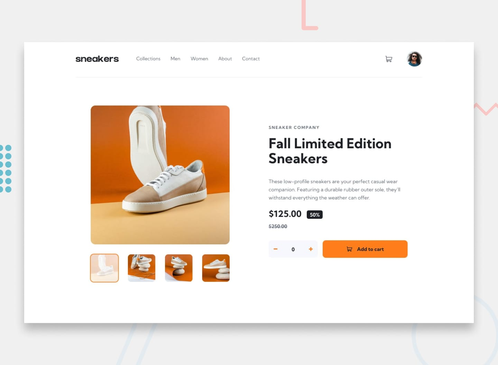
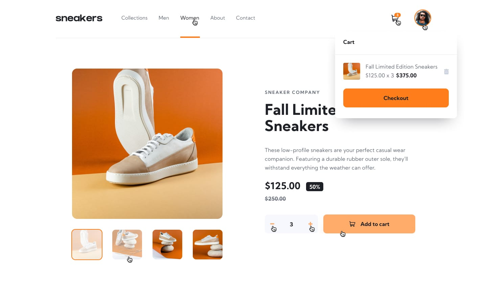
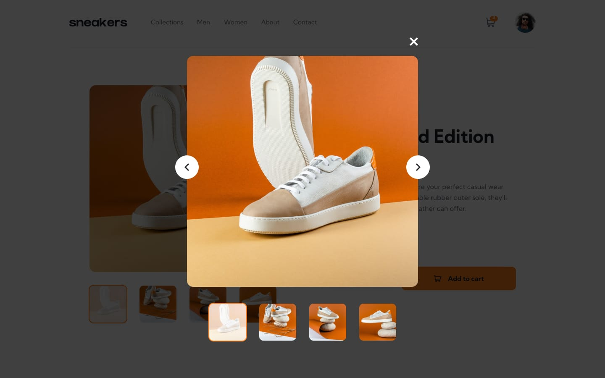
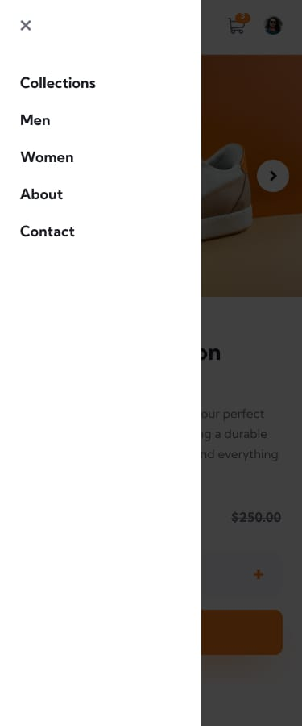
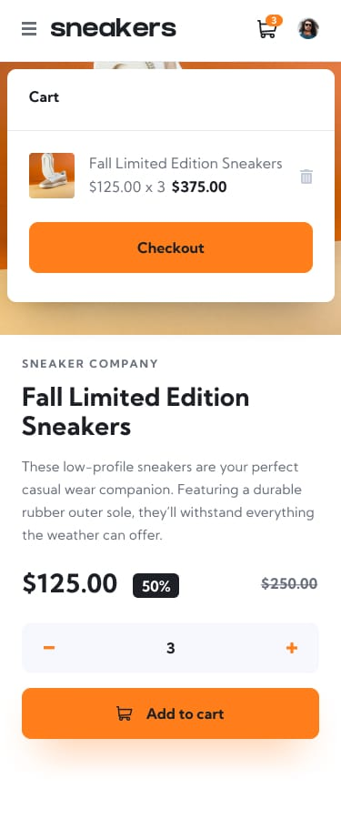

# Frontend Mentor - E-commerce product page solution

This is a solution to the [E-commerce product page challenge on Frontend Mentor](https://www.frontendmentor.io/challenges/ecommerce-product-page-UPsZ9MJp6). Frontend Mentor challenges help you improve your coding skills by building realistic projects.

## Table of contents

- [Overview](#overview)
  - [The challenge](#the-challenge)
  - [Features](#features)
  - [Screenshot](#screenshot)
  - [Links](#links)
  - [Running locally](#running-locally)
  - [Project structure](#project-structure)
- [My process](#my-process)
  - [Built with](#built-with)
  - [What I learned](#what-i-learned)
  - [Continued development](#continued-development)
  - [Useful resources](#useful-resources)
- [Author](#author)
- [Acknowledgments](#acknowledgments)

## Overview

### The challenge

Users should be able to:

- View the optimal layout for the site depending on their device's screen size
- See hover states for all interactive elements on the page
- Open a lightbox gallery by clicking on the large product image
- Switch the large product image by clicking on the small thumbnail images
- Add items to the cart
- View the cart and remove items from it

### Features

- **Responsive layout** – separate mobile, tablet (`md`) and desktop (`xl`) layouts, from a hamburger menu and arrow-controlled slider on small screens to an inline navigation and a thumbnail gallery on large ones.
- **Mobile menu** – a white side drawer over a dark overlay, closed with the X button or by clicking outside it. Page scrolling is locked while it's open.
- **Image gallery** – on mobile and tablet, previous/next arrows loop through the four product photos with a sliding transition. On desktop, the thumbnails below the main image switch the photo and the active one gets an orange ring.
- **Lightbox (desktop)** – clicking the main image opens a larger view with its own thumbnails and arrows. It closes with the X button, <kbd>Esc</kbd> or a click on the backdrop, and the <kbd>←</kbd> / <kbd>→</kbd> keys move between photos.
- **Quantity selector** – minus and plus buttons; the quantity can't go below zero.
- **Cart** – "Add to cart" puts the sneakers in the cart. The cart icon gets a badge with the quantity, and the dropdown shows the thumbnail, the name, `$125.00 x 3` and the total. It has a delete button that empties the cart, a Checkout button, and an empty state ("Your Cart is empty."). It closes when you click outside it.
- **Hover and active states** – the cart icon, the avatar ring, thumbnails and navigation links all react to hover/press.
- **Shared state and data** – the cart lives in a React Context, and the product, its images and the icons come from one `data.js` file.

### Screenshot

Design files from the challenge (the `design/` folder) that this page is built from:








### Links

- Solution URL: [on GitHub](https://github.com/AristarhMD/ecommerce-product-page.git)
- Live Site URL: [on Netlify](https://e-commerce-product-page-vn.netlify.app/)

### Running locally

```bash
# install dependencies
npm install

# start the dev server
npm run dev

# lint the code
npm run lint

# create a production build in dist/
npm run build

# preview the production build
npm run preview
```

### Project structure

```
├── index.html
├── vite.config.js
├── eslint.config.js
├── package.json
├── design                         # Design files from the challenge
├── public
│   ├── favicon.svg
│   └── icons.svg
└── src
    ├── main.jsx                   # App entry point
    ├── index.css                  # Tailwind import, theme tokens, text presets
    ├── data
    │   └── data.js                # Product data and image/icon imports
    ├── assets
    │   └── images                 # Product photos, thumbnails, icons, logo, avatar
    └── components
        ├── App.jsx                # Context provider + Navigation + MainContent
        ├── DataContext.jsx        # Cart state (React Context)
        ├── Navigation.jsx         # Header layout
        ├── MainContent.jsx        # Slider + product content
        └── reusable
            ├── LeftSideNav.jsx    # Hamburger button, logo, desktop nav
            ├── RightSideNav.jsx   # Cart button with badge, avatar
            ├── MobNavMenu.jsx     # Mobile side drawer
            ├── NavList.jsx        # Navigation links
            ├── CartModal.jsx      # Cart dropdown
            ├── Slider.jsx         # Gallery: arrows (mobile) / thumbnails (desktop)
            ├── LightBoxSlider.jsx # Lightbox modal
            └── Content.jsx        # Product details, quantity selector, Add to cart
```

## My process

### Built with

- Semantic HTML5 markup
- [React 19](https://react.dev/) - JS library (hooks and the Context API)
- [Vite](https://vite.dev/) - Dev server and build tool
- [Tailwind CSS v4](https://tailwindcss.com/) (via `@tailwindcss/vite`) - Utility-first styling with design tokens defined in CSS
- Flexbox
- Mobile-first workflow
- [ESLint](https://eslint.org/) - Flat config with the React Hooks and React Refresh rules
- [Kumbh Sans](https://fonts.google.com/specimen/Kumbh+Sans) - Typeface from Google Fonts

### What I learned

**Sharing state across the page with Context.** The cart is needed in several places that aren't parent and child: the product section writes to it, while the header shows a badge and the dropdown lists the contents. A small context provider at the top of the tree keeps all of them in sync without prop drilling:

```jsx
const DataContext = createContext();

function DataProivder({ children }) {
  const [orderedItem, setOrderedItem] = useState([]);
  return (
    <DataContext.Provider value={{ orderedItem, setOrderedItem }}>
      {children}
    </DataContext.Provider>
  );
}
```

**A slider is just a row of images that slides.** All images sit side by side in one flex row, and a single `activeSlide` index moves the row with `translateX`. Using the functional form of `setState` makes the previous/next buttons wrap around at both ends:

```jsx
const handlePrevSlide = () =>
  setActiveSlide((prev) => (prev === 0 ? lastSlideIdx : prev - 1));

const handleNextSlide = () =>
  setActiveSlide((prev) => (prev === lastSlideIdx ? 0 : prev + 1));

<div
  className="flex h-full transition-all duration-300 ease-in-out"
  style={{ transform: `translateX(-${activeSlide * 100}%)` }}
>
  {images.map((img, idx) => (
    
  ))}
</div>;
```

**Reacting to the screen size in JavaScript, not just CSS.** The lightbox should only exist on desktop, where a large image is clickable and the thumbnails are visible. CSS can't stop a click handler from running, so the handler checks the media query itself:

```jsx
const DESKTOP_QUERY = "(min-width: 1280px)";

const handleOpenModal = () => {
  if (!window.matchMedia(DESKTOP_QUERY).matches) return;
  setiIsModalOpen(true);
};
```

**Closing a dropdown on an outside click.** The cart listens for `pointerdown` on the whole document and ignores the click if it's inside the cart or on the cart's toggle button – otherwise the same click would close and instantly reopen it. The cleanup function removes the listener:

```jsx
useEffect(() => {
  const handlePointerDown = (e) => {
    if (e.target.closest("[data-cart-toggle]")) return;
    if (cartRef.current?.contains(e.target)) return;
    setIsCartOpen(false);
  };

  document.addEventListener("pointerdown", handlePointerDown);

  return () => document.removeEventListener("pointerdown", handlePointerDown);
}, [isCartOpen, setIsCartOpen]);
```

**Design tokens in CSS, and recolouring SVG icons.** The palette, shadows and font live in an `@theme` block, and each text style from the design is a custom `@utility`. Icons loaded through `` can't take a `fill-*` class, so their hover colour is changed with an arbitrary CSS `filter` value instead (shortened below):

```css
@theme {
  --color-grey-950: #1d2026;
  --color-orange-500: #ff7e1b;
  --shadow-addCart: 0 20px 50px -20px #ff7e1b40;
  --font-sans: "Kumbh Sans", sans-serif;
}

@utility preset-2 {
  @apply font-bold text-[1.75rem] leading-8 tracking-normal;
}
```

```jsx

```

### Continued development

- **Cart logic** - Persist the cart in `localStorage` so it survives a refresh.
- **Accessibility**
  - Icon-only buttons take their name from the image's `alt` text (e.g. "Hamburger menu icon"). An `aria-label` on the button would be clearer, with `alt=""` on the icon.
  - The gallery `alt` texts ("Sneaker front view", "back view", …) are guesses, so they should describe what's actually in each photo.
- **Cleanup**
  - Fix typos in names: `DataProivder`, `LigthBoxSlider`, `setiIsModalOpen`, `OnNext`, `curretOrder`, the `sneakker-001` product id, and "clouser" in an `aria-label`.
  - `active:bg-white-75` isn't a valid class (it should be `active:bg-white/75`).

### Useful resources

- [React documentation](https://react.dev/) - Reference for hooks, Context and effect cleanup.
- [Tailwind CSS documentation](https://tailwindcss.com/docs) - Covers the v4 CSS-first setup with `@theme` and `@utility`.
- [Tailwind CSS: hover, focus and other states](https://tailwindcss.com/docs/hover-focus-and-other-states) - Explains `group`, `active:` and the other state variants used here.
- [MDN: Window.matchMedia()](https://developer.mozilla.org/en-US/docs/Web/API/Window/matchMedia) - Checking media queries from JavaScript.
- [Vite guide](https://vite.dev/guide/) - Project setup, static assets and building for production.

## Author

- GitHub - [@AristarhMD](https://github.com/AristarhMD)
- Frontend Mentor - [@AristarhMD](https://www.frontendmentor.io/profile/AristarhMD)
- LinkedIn - [@Victor](https://www.linkedin.com/in/victor-nani-4b7a13179/)

## Acknowledgments

Thanks to [Frontend Mentor](https://www.frontendmentor.io) for the challenge, the design and the starter assets.
